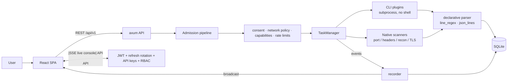

<p align="center">
  
  
  
  
</p>

<h1 align="center">SecuScan v2</h1>

<p align="center"><strong>Local-first security scanning workspace — rewritten in Rust and React.</strong></p>

> **Authorized use only.** Run SecuScan exclusively against systems you own, systems you are
> explicitly permitted to assess, or deliberately vulnerable lab environments. Every scan
> requires consent confirmation, and every blocked target attempt is recorded in an audit log.

---

## What is this?

SecuScan is an open-source workspace for running and organizing authorized security scans:
a plugin catalogue, a task runner with live streaming output, normalized findings with an
analyst triage workflow, report exports, multi-user access control, and client/project
**workspaces with a registered-target registry** — all local-first.

**v2 is a ground-up rewrite** of the original Python/FastAPI project in **Rust + React**:

| | v1 | v2 |
|---|---|---|
| Backend | FastAPI (Python 3.11) | Rust (axum + tokio + sqlx) |
| Frontend | React + TS | React 18 + TS + Vite + React Query (redesigned) |
| Plugins | `metadata.json` + `parser.py` (code, subprocess sandbox) | **single declarative TOML manifest** (no plugin code ever executes) |
| Scanning | external tools only | external tools **+ 4 built-in native Rust scanners** |
| Auth | single API key | JWT + rotating refresh cookies + argon2 + roles + API keys |
| Output streaming | SSE | SSE with DB replay + cursor-based reconnection |
| Reports | csv/html/pdf/sarif | md/csv/html/sarif/json **+ pdf/docx/xlsx**, min-severity filter, **async report jobs with signed webhooks** |
| Safety | consent, network policy | consent, network policy **with host canonicalization + audit log**, per-plugin concurrency/hourly limits, argv hardening |
| Organization | flat task list | **workspaces + first-class targets** (per-client/project scoping of tasks, findings and dashboard) |
| Run comparison | none | **scan diff**: new / fixed / regressed / improved / unchanged between runs |
| Automation | none | **recurring schedules**: interval-based scans launched by a background worker, overlap guard, run-now, full re-admission every run |

## Architecture



## Quick start

### From source

```bash
# backend (Rust 1.75+)
cargo build --workspace
./target/debug/secuscan-server          # API + UI on http://127.0.0.1:8080

# first run prints a generated admin password in the log — or set your own:
SECUSCAN_ADMIN_EMAIL=you@example.com \
SECUSCAN_ADMIN_PASSWORD=change-me-now \
./target/debug/secuscan-server
```

```bash
# frontend dev server (optional; the server also serves the built SPA)
cd frontend && npm ci && npm run dev    # http://127.0.0.1:5173 (proxies /api)
```

### Docker

```bash
docker compose -f docker/docker-compose.yml up --build
# open http://127.0.0.1:8080
```

### CLI (no server needed)

```bash
./target/debug/secuscan scan --plugin port-scanner \
  --input target=127.0.0.1 --input ports=22,80,443 \
  --consent --output report.md
```

## The plugin catalogue

13 plugins ship in `plugins/` — see [`docs/PLUGIN_DEVELOPMENT.md`](docs/PLUGIN_DEVELOPMENT.md)
for the full manifest reference.

| Plugin | Kind | Category | Safety |
|---|---|---|---|
| `port-scanner` | **native** | network | safe |
| `http-headers` | **native** | web | safe |
| `http-recon` | **native** | recon | safe |
| `tls-check` | **native** | web | safe |
| `nmap` | cli | network | safe |
| `nikto` | cli | web | intrusive |
| `nuclei` | cli | web | intrusive |
| `gobuster` | cli | web | intrusive |
| `whatweb` | cli | recon | safe |
| `traceroute` | cli | network | safe |
| `whois` | cli | recon | safe |
| `ping` | cli | network | safe |
| `sqlmap` | cli | web | **exploit** |

Native plugins need zero external tooling. CLI plugins auto-detect missing binaries and the
UI marks them unavailable until installed.

## Safety model

- **Consent gate** — plugins (and/or the whole instance) require explicit acknowledgment
  before any task starts.
- **Target policy** — three layers, in order: global deny-list → global allow-list →
  plugin `allowed_targets`. Hosts are canonicalized first (IPv4-mapped IPv6, integer IPv4
  forms) and IPv4-shaped globs never match hostnames. Network-layer plugins default to
  private ranges only.
- **Argv hardening** — commands are argv vectors (never a shell string); values starting
  with `-` are rejected unless a field explicitly opts in.
- **Executor isolation** — per-task temp working dir, scrubbed environment (platform
  secrets never reach tools), wall-clock timeouts, kill-on-cancel, output caps.
- **Rate limits** — per-plugin max concurrency + hourly caps, plus a global task limit.
- **Audit log** — every policy-blocked target attempt is recorded and viewable by admins.

*Known boundary:* hostname-based policy matching trusts DNS at task-creation time (a DNS
record can change). Use IP/CIDR patterns for strict enforcement; see
[`SECURITY.md`](SECURITY.md).

## Testing

```bash
cargo test --workspace          # 113 backend tests (unit + integration over real HTTP)
cd frontend && npm test         # 64 frontend tests
cargo clippy --workspace --all-targets -- -D warnings
```

Integration tests boot the real axum app with a temporary database, real plugin manifests
and live listeners — covering auth flows, the task lifecycle, SSE replay, reports, RBAC,
the network policy engine and every audit-fix regression.

## Documentation

- [`docs/ARCHITECTURE.md`](docs/ARCHITECTURE.md) — crates, data flow, task lifecycle
- [`docs/API.md`](docs/API.md) — REST reference with curl examples
- [`docs/PLUGIN_DEVELOPMENT.md`](docs/PLUGIN_DEVELOPMENT.md) — write your own plugin in one TOML file
- [`docs/DEPLOYMENT.md`](docs/DEPLOYMENT.md) — configuration, Docker, reverse proxy
- [`docs/REVIEW_LOG.md`](docs/REVIEW_LOG.md) — the six review cycles behind this release
- [`SECURITY.md`](SECURITY.md) — security policy and responsible use

## Relationship to SecuScan v1

This repository is an independent rewrite. The original project
(https://github.com/utksh1/SecuScan) remains the reference implementation; migration is a
deliberate, manual decision for the maintainer. v1 features intentionally deferred:
credential vault, notification/webhook rules, scheduled workflow ticks, saved views, and
attack-surface assets — the architecture accommodates all of them (see the roadmap in
`docs/ARCHITECTURE.md`).

## License

MIT — see [LICENSE](LICENSE). Wrapped external tools (nmap, nuclei, sqlmap…) keep their
own licenses and usage terms.
