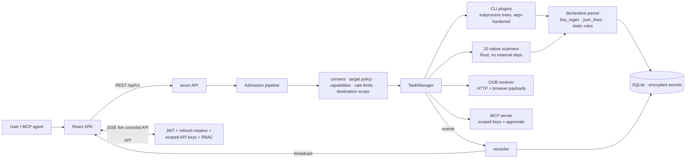

<p align="center">
  
  
  
  
</p>

<h1 align="center">SecuScan</h1>

<p align="center"><strong>Local-first authorized-security-scanning workspace, in Rust and React.</strong></p>

> **Authorized use only.** Run SecuScan exclusively against systems you own, systems you are
> explicitly permitted to assess, or deliberately vulnerable lab environments. Every scan
> requires consent confirmation, every target passes a three-layer admission policy, every
> blocked attempt is audited, and outbound destinations are enforced at connection time.

---

## What is this?

SecuScan is a self-hosted workspace for running and organizing authorized security scans:
a 50-plugin catalogue (native Rust scanners + wrapped open-source tools), a task runner
with live streaming output, deduplicated findings with an analyst triage workflow,
multi-scan reporting, an MCP server for LLM agents, and workspaces with a registered-target
registry — all local-first, single binary + SQLite.

### Capability highlights

| Area | What ships |
|---|---|
| **Scanning** | 50 plugins (17 native Rust, 33 wrapped CLI tools) with per-scanner Light/Deep/Custom profiles; one-POST **attack suites** per target |
| **Findings** | Dedup groups, false-positive **memory across rescans**, severity override (resettable, survives re-scans), CVSS/CVE/CWE/OWASP/EPSS/KEV enrichment, bulk triage, cursor pagination |
| **Verification** | **Sniper** auto-exploiter (finding → exploit chain), **OOB callbacks** (HTTP receiver + browser-capture payloads, marker-correlated auto-findings) |
| **Orchestration** | **Pentest Robots** (multi-tool DAG), workflows, recurring schedules with **named frequencies** (daily/weekly/monthly + timezone), **auto-diff** on scheduled runs firing a `diff` notification trigger |
| **Lifecycle** | Honest terminal states (`status_detail`: timed_out / auth_failed / cancelled), partial findings preserved on cancel, `max_scan_time` soft caps, process-tree termination, bounded output capture, exit-code honesty |
| **Egress safety** | Three-layer target admission (deny → allow → per-plugin) with host canonicalization + audit log; **connect-time destination enforcement** (DNS re-resolution, metadata-endpoint refusal, address pinning, same-host redirects); webhook egress policy (no redirects, resolve-at-send, bounded bodies) |
| **AI surface** | **MCP server** (17 tools) with scoped API keys, human-approved one-use scan approvals, consent gates — the deterministic base layer for agentic workflows |
| **Reporting** | 8 formats (JSON/MD/CSV/HTML/SARIF/PDF/DOCX/XLSX), multi-scan aggregation-ready job pipeline with HMAC-signed webhooks, white-label branding, executive enrichment rendering |
| **Platform** | Multi-user RBAC + workspace membership, API keys with expiry + MCP scopes, TOTP-ready auth base, at-rest encryption (AES-256-GCM), per-user rate limits, VPN-pinned internal scanning, notifications (Slack/Teams/Discord/webhook), scan-completion callbacks |

## Architecture



Six crates: `core` (models, policy, parser, templates, net scope), `db` (sqlx + migrations),
`exec` (runner, native scanners, OOB context), `api` (routes, manager, scheduler,
notifications, reports), `mcp` (JSON-RPC 2.0 server), `cli` (offline runner, OpenAPI export).
See [`docs/ARCHITECTURE.md`](docs/ARCHITECTURE.md).

## Quick start

### From source

```bash
# backend (Rust 1.75+)
cargo build --workspace
SECUSCAN_ENV=development SECUSCAN_ADDR=127.0.0.1:8080 \
  ./target/debug/secuscan-server   # local-only dev; ephemeral JWT key

# first run prints a generated admin password in the log — or set your own:
SECUSCAN_ENV=development SECUSCAN_ADDR=127.0.0.1:8080 \
SECUSCAN_ADMIN_EMAIL=you@example.com \
SECUSCAN_ADMIN_PASSWORD='choose-a-strong-password' \
./target/debug/secuscan-server
```

```bash
# frontend dev server (optional; the server also serves the built SPA)
cd frontend && npm ci && npm run dev    # http://127.0.0.1:5173 (proxies /api)
```

### Docker

Production requires a persistent, securely generated JWT signing key; Docker
Compose refuses to boot without it. See [the deployment guide](docs/DEPLOYMENT.md)
for the full env surface (encryption key, public URL for OOB, outbound policy,
rate limits).

```bash
# One-time setup. Preserve .env on subsequent restarts.
umask 077
if [ ! -e .env ]; then
  printf 'SECUSCAN_JWT_SECRET=%s\n' "$(openssl rand -hex 32)" > .env
fi
docker compose --env-file .env -f docker/docker-compose.yml up --build
# open http://127.0.0.1:8080
```

### CLI (no server needed)

```bash
./target/debug/secuscan scan --plugin port-scanner \
  --input target=127.0.0.1 --input ports=22,80,443 \
  --consent --output report.md
```

## The plugin catalogue

50 plugins ship in `plugins/` — 17 **native Rust scanners** (zero external
tooling) and 33 wrapped CLI tools (auto-detected; the UI marks missing
binaries unavailable). Every plugin carries a declarative TOML manifest —
see [`docs/PLUGIN_DEVELOPMENT.md`](docs/PLUGIN_DEVELOPMENT.md) for the full
reference (parsers, presets, safety blocks, `ok_exit_codes`, capabilities).

<details>
<summary><strong>Full catalogue (50)</strong></summary>

**Native (17):** `api-scanner` · `cloud-scanner` · `cors-check` · `dns-lookup` ·
`domain-finder` · `drupal-scanner` · `email-security` · `google-dorks` ·
`http-headers` · `http-recon` · `http-request-logger` · `js-analyzer` ·
`param-finder` · `password-audit` · `people-hunter` · `port-scanner` ·
`reverse-dns` · `subdomain-finder` · `tls-check` · `vhost-finder` ·
`website-scanner` · `xss-exploiter`

**CLI — network:** `fast-port-scan` · `nmap` · `ping` · `service-defaults` ·
`smb-enum` · `ssh-audit` · `testssl` · `traceroute` · `udp-port-scan`

**CLI — recon:** `subfinder` · `whatweb` · `whois`

**CLI — web:** `command-injection` · `crawler` · `feroxbuster` · `ffuf` ·
`gobuster` · `http-probe` · `http-smuggling` · `nikto` · `nuclei` ·
`secrets-scanner` · `sqlmap` · `subdomain-takeover` · `waf-detect` ·
`wordpress-audit` · `xss-scanner`

**Exploitation:** `sqli-exploiter` (CLI) · `http-request-logger` ·
`xss-exploiter` (native)

</details>

## Safety model

- **Consent gate** — plugins (and/or the whole instance) require explicit acknowledgment
  before any task starts; admission re-runs on every scheduled occurrence.
- **Target policy** — three layers, in order: global deny-list → global allow-list →
  plugin `allowed_targets`. Hosts are canonicalized first (IPv4-mapped IPv6, integer IPv4
  forms) and IPv4-shaped globs never match hostnames.
- **Connect-time destination scope** — targets are re-resolved at scan start and every
  DNS answer is validated; cloud metadata endpoints are always refused; web scanners
  pin the validated addresses so mid-scan DNS rebinding cannot move the scan; redirects
  stay on the original target host. `SECUSCAN_OUTBOUND_*` knobs configure strict mode
  and authorized private-lab scanning.
- **Argv hardening** — commands are argv vectors (never a shell string); values starting
  with `-` are rejected unless a field explicitly opts in.
- **Executor isolation** — per-task process groups (the whole tree dies on cancel/timeout),
  per-task temp working dir, scrubbed environment, wall-clock timeouts, bounded output
  capture, honest exit-code classification.
- **Rate limits** — per-plugin max concurrency + hourly caps, a global task limit, and
  per-credential API rate limits with `X-RateLimit-*` headers.
- **Audit log** — every policy-blocked target attempt is recorded and viewable by admins.

Residual boundaries (DNS pinning scope, single-node execution, no TOTP yet) are documented
in [`SECURITY.md`](SECURITY.md).

## Testing

Backend (`cargo test --workspace`) and frontend (`npm test`) suites run in CI
alongside clippy, rustfmt, the E2E verification script (`scripts/verify.mjs` —
200+ checks driving a real server), and Docker smoke tests. Current test counts
live in the CI badge and the changelog rather than this file, so they cannot go
stale.

Integration tests boot the real axum app with a temporary database, real plugin
manifests and live listeners — covering auth flows, the task lifecycle, SSE
replay, reports, RBAC, the network policy engine, the OOB pipeline, diff
notifications and every audit-fix regression.

## Documentation

- [`docs/ARCHITECTURE.md`](docs/ARCHITECTURE.md) — crates, data flow, task lifecycle, trust boundaries
- [`docs/API.md`](docs/API.md) — REST reference with curl examples
- [`docs/PLUGIN_DEVELOPMENT.md`](docs/PLUGIN_DEVELOPMENT.md) — write your own plugin in one TOML file
- [`docs/DEPLOYMENT.md`](docs/DEPLOYMENT.md) — configuration, Docker, reverse proxy, OOB, outbound policy
- [`docs/MAX_PARITY_PLAN.md`](docs/MAX_PARITY_PLAN.md) — the phased parity roadmap and its acceptance criteria
- [`docs/MCP_SETUP.md`](docs/MCP_SETUP.md) — connect Claude/Cursor/VS Code agents to SecuScan
- [`docs/MCP_CONSENT.md`](docs/MCP_CONSENT.md) — human-authorized one-use MCP scan approvals and safety limits
- [`docs/REVIEW_LOG.md`](docs/REVIEW_LOG.md) — the review cycles behind this release
- [`SECURITY.md`](SECURITY.md) — security policy, threat boundaries, outbound policy

## License

MIT — see [LICENSE](LICENSE). Wrapped external tools (nmap, nuclei, sqlmap…) keep their
own licenses and usage terms.
